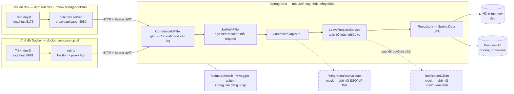
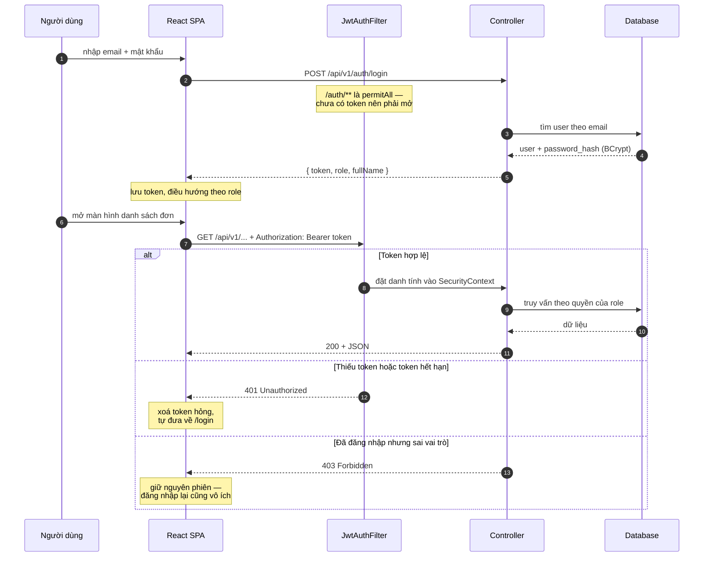
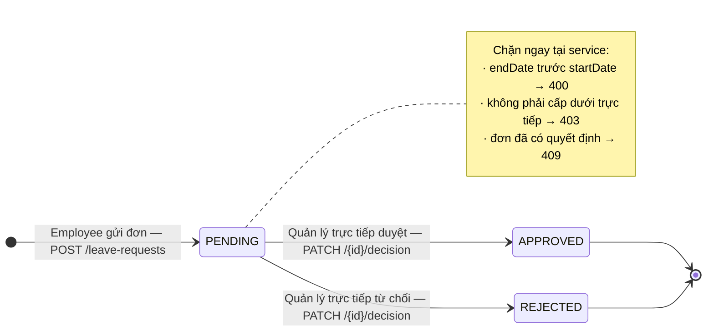
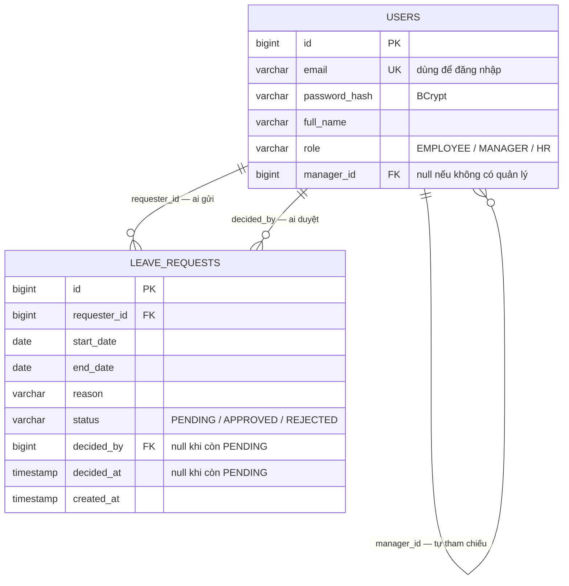

# Leave Approval System — Mini SE Project

Một hệ thống duyệt nghỉ phép nội bộ (**Leave Approval System**), xây theo đúng cách một team thật sẽ làm — nhỏ gọn, nhưng đủ chuẩn để cắm vào một hệ thống doanh nghiệp lớn hơn. Đây là project mini dành cho sinh viên → junior dev, đi kèm series 4 video giải thích tư duy đằng sau từng quyết định kỹ thuật.

## Bài toán

- **Employee** gửi đơn xin nghỉ (ngày bắt đầu, ngày kết thúc, lý do).
- **Manager** duyệt/từ chối đơn của những người báo cáo trực tiếp cho mình.
- **HR** xem toàn bộ đơn trong công ty.

Giống hệt việc học sinh xin nghỉ học và giáo viên chủ nhiệm duyệt — chỉ khác là có thêm vai trò, quyền hạn, và phải chạy được trong môi trường doanh nghiệp thật.

## 4 giai đoạn (khớp 4 video)

| Stage | Nội dung | Thư mục | Video |
|---|---|---|---|
| 1 | Thiết kế: yêu cầu, ERD, kiến trúc | `docs/` | Video 1 |
| 2 | Backend & API (Spring Boot, JWT auth) | `backend/` | Video 2 |
| 3 | Frontend & tích hợp (React) | `frontend/` | Video 3 |
| 4 | Test, Docker, CI/CD, tích hợp doanh nghiệp mô phỏng | `backend/.../integration/`, `docker/`, `.github/` | Video 4 |

## Yêu cầu môi trường

| Cần gì | Phiên bản | Ghi chú |
|---|---|---|
| JDK | 21 | Không cần cài Maven — repo có sẵn Maven Wrapper (`./mvnw`) |
| Node.js | ≥ 22.12 (hoặc ≥ 20.19) | Vite 8 yêu cầu; Node 20 đã hết hạn hỗ trợ từ 04/2026 |
| Docker | bản mới | Chỉ cần cho Stage 4 |

## Cách chạy từng stage

**Stage 2 — chỉ backend (không cần Docker):**
```bash
cd backend
./mvnw spring-boot:run     # Windows: mvnw.cmd spring-boot:run
```
- API: `http://localhost:8080/api/v1/...`
- Swagger UI (tài liệu API — cũng là "hợp đồng" để hệ thống khác tích hợp vào): `http://localhost:8080/swagger-ui.html`
- Health check (để load balancer/k8s biết app còn sống): `http://localhost:8080/actuator/health`
- Tài khoản demo (xem `backend/src/main/resources/data.sql`): `manager@co.com` / `employee1@co.com` / `hr@co.com`, mật khẩu `password123`

**Stage 3 — full stack:**
```bash
# terminal 1
cd backend && ./mvnw spring-boot:run
# terminal 2
cd frontend && npm install && npm run dev
```
Mở `http://localhost:5173`, đăng nhập bằng 1 trong 3 tài khoản demo ở trên.

**Stage 4 — chạy toàn bộ qua Docker (giống môi trường thật hơn, dùng Postgres thay vì H2):**
```bash
cp .env.example .env       # đổi giá trị thật nếu không phải chạy demo local
docker compose up --build
```
Frontend: `http://localhost:8081` · Backend: `http://localhost:8080`. Compose đợi Postgres
và backend *thật sự* sẵn sàng (healthcheck) rồi mới khởi động lớp sau, nên lần chạy đầu
không bị 502.

**Chạy test:**
```bash
cd backend && ./mvnw verify   # 3 unit test + 2 integration test
cd frontend && npm run build  # frontend chưa có test tự động (xem "Giới hạn đã biết")
```

## Sơ đồ hệ thống

Năm sơ đồ mô tả: hệ thống chạy ở đâu, một request đi qua những lớp nào, đơn nghỉ chuyển
trạng thái ra sao, dữ liệu nằm ở đâu, và ai được làm gì.

### 1. Kiến trúc runtime — hai chế độ chạy

Cùng một mã nguồn, hai cách chạy. Khác nhau đúng hai chỗ: ai phục vụ file tĩnh và chuyển
tiếp `/api`, và dùng H2 trong bộ nhớ hay Postgres thật.



Nét đứt là hai điểm nối còn mock, chưa cắm vào hệ thống thật.

**Vì sao cả hai chế độ đều proxy `/api`?** Để frontend luôn gọi đường dẫn tương đối
`/api/v1/...` — trình duyệt thấy cùng một origin nên không phát sinh CORS, và backend không
phải cấu hình CORS chỉ để phục vụ môi trường dev.

### 2. Luồng xác thực — đăng nhập rồi gọi API

Server không lưu session. Mỗi request tự chứng minh danh tính bằng JWT trong header, nên
bất kỳ instance backend nào cũng xử lý được — đây là điều kiện để scale ngang.



**401 khác 403 ở chỗ nào?** Mặc định Spring Security trả 403 cho cả hai. Hệ thống này tách
ra: `401` = *chưa có danh tính hợp lệ* → frontend xoá token và đưa về màn đăng nhập.
`403` = *đúng người nhưng không đủ quyền* → giữ nguyên phiên, vì đăng nhập lại vô ích.

### 3. Vòng đời một đơn nghỉ phép

Ba trạng thái, quyết định một chiều — đã duyệt hoặc đã từ chối thì không quay lại được.



Ba phép kiểm tra trên nằm ở `LeaveRequestService.decide()`, không nằm ở controller.

**Vì sao kiểm tra "cấp dưới trực tiếp" không đặt ở `@PreAuthorize`?** Annotation chỉ biết
vai trò của người gọi, không biết dữ liệu của đơn cụ thể. Muốn biết đơn số 3 có phải của
cấp dưới mình hay không thì phải đọc database — nên phép kiểm tra này thuộc tầng service.

### 4. Mô hình dữ liệu



Không có bảng `roles` vì role là enum ba giá trị, gần như không đổi — chi tiết ở
`docs/erd.md`.

### 5. Ma trận phân quyền

| Endpoint | Employee | Manager | HR | Trả về gì |
|---|---|---|---|---|
| `POST /api/v1/auth/login` | mở | mở | mở | token, role, fullName |
| `POST /api/v1/leave-requests` | **201** | 403 | 403 | Đơn vừa tạo, trạng thái PENDING |
| `GET /api/v1/leave-requests/mine` | **200** | 403 | 403 | Đơn của chính mình |
| `GET /api/v1/leave-requests/team` | 403 | **200** | 403 | Đơn của cấp dưới trực tiếp |
| `PATCH /api/v1/leave-requests/{id}/decision` | 403 | **200** | 403 | Đơn sau quyết định — kèm kiểm tra cấp dưới trực tiếp |
| `GET /api/v1/leave-requests` | 403 | 403 | **200** | Toàn bộ đơn công ty, lọc được theo `?status=` |
| `GET /actuator/health` | mở | mở | mở | Cho load balancer / Kubernetes |

**Manager gọi `GET /leave-requests` bị 403 là đúng thiết kế** — endpoint đó dành riêng cho
HR xem toàn công ty; quản lý dùng `/team` để chỉ thấy cấp dưới của mình.

### Kiểm chứng nhanh toàn bộ luồng

Gọi qua cổng 8081 (tức đi đúng đường trình duyệt đi, không gọi tắt vào backend):

```bash
login() { curl -s -X POST http://localhost:8081/api/v1/auth/login \
  -H "Content-Type: application/json" \
  -d "{\"email\":\"$1\",\"password\":\"password123\"}" | grep -o '"token":"[^"]*"'; }

EMP=$(login employee1@co.com); MGR=$(login manager@co.com); HR=$(login hr@co.com)
# 1. employee tạo đơn -> 201 PENDING
# 2. manager GET /team -> thấy đơn đó
# 3. manager PATCH /{id}/decision -> APPROVED, ghi decidedBy
# 4. HR GET /leave-requests -> thấy toàn bộ
# 5. employee PATCH /{id}/decision -> 403
# 6. gọi không kèm token -> 401
```

## Vì sao dự án nhỏ nhưng không phải "code demo"

Mọi lựa chọn đơn giản hóa trong project này (VD: `schema.sql` thay vì Flyway, JWT không có refresh-token, không có màn đăng ký user) là quyết định có chủ đích ở quy mô nhỏ — không phải thiếu sót. Từng điểm được ghi chú `ponytail:` ngay trong code, kèm lý do và "nếu lớn hơn thì nâng cấp thế nào". Đọc file `docs/architecture.md` để biết chi tiết.

## Giới hạn đã biết (chưa cần sửa cho mini project)

`schema.sql` thay vì Flyway · JWT không refresh-token · không có đăng ký user (chỉ seed sẵn) · frontend chưa có test tự động · API list chưa phân trang · mật khẩu seed dùng chung cho demo.
