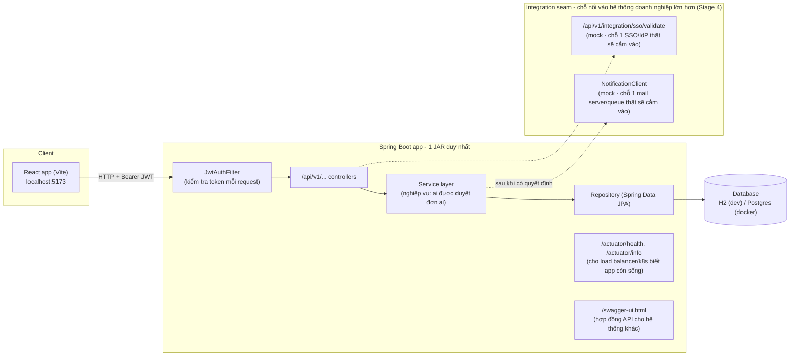

# Kiến trúc & quyết định kỹ thuật

## Sơ đồ tổng thể

## Bảng quyết định tech stack

| Quyết định | Lý do chọn | Khi nào nên đổi |
|---|---|---|
| Spring Boot (1 module), không tách microservice | Team nhỏ, 1 bounded context (leave management), tách sớm chỉ tạo overhead vận hành | Khi có nhiều team làm việc độc lập trên các phần khác nhau, hoặc cần scale riêng từng phần |
| React + Vite, không Next.js | Đây là internal tool, không cần SEO/SSR | Nếu sau này cần trang public-facing cần SEO |
| `schema.sql`/`data.sql`, không Flyway | 2 bảng, schema chưa từng đổi - Flyway là công cụ **quản lý lịch sử thay đổi schema qua thời gian**, chưa cần thiết khi schema còn ổn định | Ngay khi có thay đổi schema thứ 2 sau khi đã deploy - lúc đó cần lịch sử migration để không mất dữ liệu |
| JWT tự triển khai, không OAuth2/Keycloak | Chỉ 1 app, không cần Identity Provider tập trung cho nhiều hệ thống | Khi có ≥ 2 hệ thống cần dùng chung 1 nơi đăng nhập |
| H2 (dev) → Postgres (docker) | Stage 2/3 chạy được ngay không cần cài DB, Stage 4 mô phỏng gần với production | - |
| Không dùng DTO-mapping library (MapStruct) | Chỉ 4 DTO, viết tay còn rõ ràng hơn học thêm 1 công cụ | Khi số lượng DTO/entity tăng lên hàng chục |
| Không dùng state-management library ở frontend (Redux...) | 3 trang, `useState`/`useEffect` là đủ | Khi state cần chia sẻ phức tạp giữa nhiều trang không liên quan |

## "Integration seam" là gì

Một hệ thống doanh nghiệp thật hiếm khi đứng một mình - nó luôn cần **nhận** thông tin đăng nhập từ một hệ thống SSO chung của công ty, và **gửi** thông báo qua một hệ thống email/queue chung. Thay vì xây 2 thứ đó thật (tốn công, không phải trọng tâm bài học), Stage 4 sẽ dựng 2 "chỗ nối" (seam) rõ ràng:

- `POST /api/v1/integration/sso/validate` - mô phỏng chỗ một SSO/IdP thật sẽ gọi vào để xác thực người dùng.
- `NotificationClient` (interface) - mô phỏng chỗ một mail server/message queue thật sẽ cắm vào để gửi thông báo.

Cách làm này - cô lập điểm tích hợp thành 1 interface/1 endpoint rõ ràng - chính là cách một senior dev thiết kế để sau này thay thế phần mock bằng phần thật **mà không phải sửa code ở nơi khác gọi đến nó**.

## API versioning, health check, correlation ID - vì sao cần dù project nhỏ

- **`/api/v1/...`**: khi API đổi (thêm field, đổi response shape), version cũ vẫn chạy cho client đang dùng - hệ thống doanh nghiệp không thể "sửa xong bắt mọi người update cùng lúc".
- **`/actuator/health`**: một load balancer/Kubernetes cần 1 endpoint để hỏi "app còn sống không" trước khi đẩy traffic vào - thiếu cái này thì không deploy được vào hạ tầng thật.
- **Correlation ID** (header `X-Correlation-Id`, gắn vào mọi dòng log): khi 1 request đi qua nhiều service, đây là cách duy nhất để lần ra toàn bộ đường đi của nó trong log khi có lỗi - thiếu cái này, debug một hệ thống nhiều service gần như không thể.
