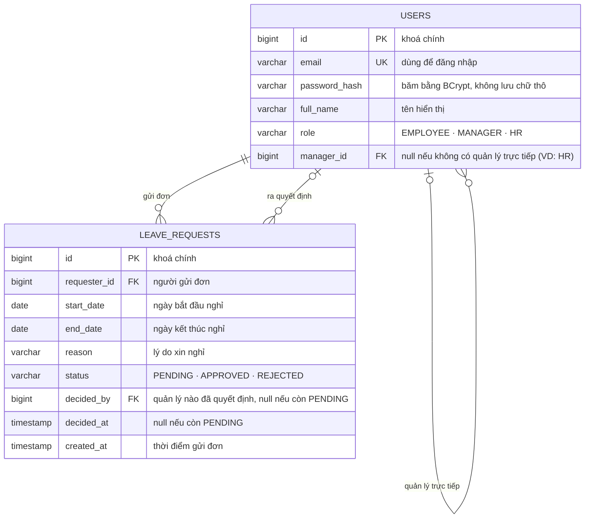

# ERD — Entity Relationship Diagram

`ERD` là sơ đồ cho biết hệ thống có những bảng dữ liệu nào và chúng liên hệ với nhau ra sao. Hệ thống này chỉ cần **2 bảng**.

Ký hiệu chân quạ ở hai đầu mỗi đường nối cho biết số lượng: `||` là bắt buộc đúng một, `|o`
là không hoặc một, `o{` là không hoặc nhiều. Hai đường dùng `|o` không phải trang trí —
chúng nói rằng user **có thể không có quản lý nào**, và đơn **có thể chưa ai quyết định**.

## Vì sao chỉ 2 bảng (không có bảng `roles`, `departments`)

- `role` là enum cố định (3 giá trị, gần như không đổi theo thời gian) → lưu thẳng dạng `varchar`, không cần bảng lookup riêng. Nếu sau này số role tăng lên và cần gán nhiều role/thay đổi linh hoạt qua UI admin, đó là lúc tách bảng `roles` — hiện tại chưa cần.
- "Quản lý trực tiếp" là quan hệ 1 cấp, dùng cột `manager_id` tự trỏ vào chính bảng `users` là đủ diễn tả — không cần mô hình cây tổ chức (`Department`/`Team`) phức tạp hơn mức bài toán yêu cầu.
